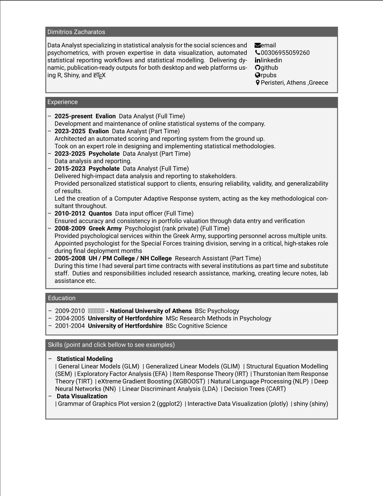

# CV (Curriculum Vitae)

This repository contains the source code and data for generating a professional CV (Curriculum Vitae) using R Markdown and LaTeX. The workflow is designed for reproducibility and easy updates, with data stored in an Excel file and rendering scripts for multiple platforms.

## Features
- **Three versions**: `cv_v0` is the original CV; `cv_v1` is the newer one, with a Projects section and a lighter layout; `cv_v2` has the content of `cv_v1` in a new layout (a full-width header band, no section boxes, every section on one date/label column). Each has its own template; all read the same data file, `cv.xlsx`.
- **Dynamic CV generation**: Main content and sections are read from `cv.xlsx` and rendered via `cv_v0.Rmd`, `cv_v1.Rmd` and `cv_v2.Rmd`.
- **PDF output**: Produces a high-quality PDF using LaTeX and the `lualatex` engine.
- **Cross-platform rendering**: Includes scripts for Linux (`render_cv.sh`), Windows (`render_cv.bat`), and PowerShell (`render_cv.ps1`).
- **Customizable**: Easily update your CV by editing the Excel file or R Markdown template.

## File Overview
- `cv.xlsx` — Excel file with the work experience, education, skills, projects, and personal details, used by all CVs. A change here shows in all of them.
  - `details`: `label` is the short text of `cv_v0` ("email"), `label_full` the full one of `cv_v1` and `cv_v2` (the address itself).
  - `examples` (skills): column `cv` is empty for skills in every CV, `v0` or `v1` for skills in one only (`cv_v2` shows the `v1` skills).
  - `projects` (`name`, `description`, `link`): only `cv_v1` and `cv_v2` show it. `cv_v2` puts the text before ": " in the description ("Shiny app") in its left column.
  - `work`: one row per position; `cv_v1` and `cv_v2` join positions at the same company that follow each other (part time, then full time) into one entry. In `cv_v2` each sentence of `responsibilities` separated by `\\` is a bullet.
- `cv_v0.Rmd` — R Markdown template of the original CV; renders to `cv_v0.pdf`.
- `cv_v1.Rmd` — R Markdown template of the new CV (Projects section, contact details in full, lighter section boxes); renders to `cv_v1.pdf`.
- `cv_v2.Rmd` — R Markdown template of `cv_v1` in a new layout (header band, no section boxes, bullets, skills as linked lists); renders to `cv_v2.pdf`.
- `cv_v0.tex`, `cv_v1.tex`, `cv_v2.tex` — Generated LaTeX files (output from rendering, not meant for direct editing).
- `render_cv.sh` — Bash script to render both CVs on Linux/macOS.
- `render_cv.bat` — Batch script to render both CVs on Windows.
- `render_cv.ps1` — PowerShell script to render both CVs on Windows.

## Requirements
- [R](https://www.r-project.org/) (with packages: `rmarkdown`, `openxlsx`, `knitr`)
- [Pandoc](https://pandoc.org/) (usually comes with RStudio)
- [LaTeX](https://www.latex-project.org/) distribution (e.g., TeX Live, MikTeX)
 Fonts: Roboto (or edit the font in `cv_v0.Rmd` / `cv_v1.Rmd`)

## How to Render

### On Linux/macOS
```bash
./render_cv.sh
```

### On Windows (Command Prompt)
```
render_cv.bat
```

### On Windows (PowerShell)
```
./render_cv.ps1
```

This will generate a PDF file from your R Markdown template and Excel data.

### On GitHub (automatic)
`.github/workflows/render-cv.yml` renders all CVs on every push to `main` that changes `cv.xlsx`, a `cv_v*.Rmd`, `render_cv.sh` or the workflow, and commits the PDFs (and their `.tex`) back to `main` as "Render CV PDFs [skip ci]". It can also be run from the Actions tab ("Run workflow"). After a push, `git pull` before the next commit: the workflow has added a commit on top of yours.

## Customization
- Edit `cv.xlsx` to update your work experience, education, skills, projects, and personal details (both CVs).
- Edit `cv_v0.Rmd` or `cv_v1.Rmd` to change the template, formatting, or add/remove sections.

## License
See `LICENSE` for details.

# Screenshots


---


